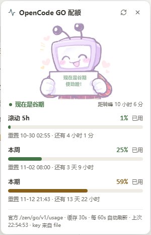

# dsh-opencode-usage

OpenCode GO 配额挂件 — 一个 [DeepSeek Harness](https://github.com/deepseek-ai/deepseek-harness)（DSH）web GUI 插件。

侧栏底部挂一个小挂件：三根迷你条 + 一个百分比（默认给"本期"），点开是一张浮层卡片，
列出 **滚动 5h / 本周 / 本期** 三个窗口的进度条、重置时间和倒计时；聊天里还有 `/opencode-go`
命令可以随手打一行。

卡片顶上还有一条**峰谷提示**：现在处于 DeepSeek 的峰价还是谷价、距下次切换还有多久，
背景是一张 50% 透明度的 Q 版（谷期举牌笑，峰期托腮省着用）。

数据来自 **官方接口**（不是抓 dashboard、不需要浏览器 cookie）：

```
GET https://opencode.ai/zen/go/v1/usage
Authorization: Bearer <OPENCODE_GO_API_KEY>

{ "usage": {
    "rolling": { "status": "ok", "percent": 0,  "resetsAt": "2026-10-03T17:47:12.000Z" },
    "weekly":  { "status": "ok", "percent": 13, "resetsAt": "2026-10-05T00:00:00.000Z" },
    "monthly": { "status": "ok", "percent": 27, "resetsAt": "2026-10-12T13:16:47.000Z" } } }
```

* `percent` = **已用**百分比；三个窗口是 rolling(5h) / weekly / monthly。
* 接口**不给美元明细**（那只有 <https://opencode.ai/auth> 控制台里有），这里也不编。
* 这个调用是纯账户状态读取，**不消耗套餐额度**。

## 安装

前提：DSH 0.2.0 或更新的 web profile，以及一个 **OpenCode GO** 订阅的 API key。

### 方式一：装 GitHub 仓库（无需 npm 账号）

```sh
dsh plugin --profile web add github:Jingshiro/dsh-opencode-usage
```

### 方式二：装 npm 包（发布后；走 registry / 镜像，国内网络更稳）

```sh
dsh plugin --profile web add dsh-opencode-usage
```

装完**重启 web 服务**（`dsh web`）生效。`dsh plugin add` 会自动把本包的
`cordis.patch.yml` 挂进 profile 的 bundle 层——**不需要手动编辑任何 patch**。

装好之后只差一行配置：把 key 放进 `$DSH_HOME/.credentials.yaml` 的 `refs` 里
（或者 `$DSH_HOME/.env`、或者进程环境变量，三层都认）：

```yaml
# ~/.dsh/.credentials.yaml
refs:
  OPENCODE_GO_API_KEY: 你的key
```

验证：浏览器访问 `http://127.0.0.1:3080/api/opencode-usage/ping`，应显示
`pong · POST 上游 https://opencode.ai/zen/go · keyRef OPENCODE_GO_API_KEY`。

## 可调配置

默认值就够用；想覆盖就在自己 profile 的 `cordis.patch.yml` 里加同 name 行：

```yaml
- id: opencode-usage
  name: dsh-opencode-usage
  config:
    baseUrl: https://opencode.ai/zen/go   # 上游网关（换代理/镜像时改这里）
    keyRef: OPENCODE_GO_API_KEY           # 凭据服务里的 ref 名
    routePrefix: /api/opencode-usage      # 同源路由前缀
    cacheMs: 30000                        # 上游缓存（路由和命令共用）
    timeoutMs: 15000                      # 单次上游超时
    holidayUrl: https://cdn.jsdelivr.net/gh/NateScarlet/holiday-cn@master/{year}.json
    holidayUrlAlt: https://raw.githubusercontent.com/NateScarlet/holiday-cn/master/{year}.json
    holidayCacheMs: 43200000              # 节假日日历缓存（12h）
```

## 聊天命令

在任意对话里打 `/opencode-go`：

```
**OpenCode GO 配额** · 22:16
- **滚动 5h** 0%  `····················`  重置 10-04 01:47（还有 3 小时 31 分）
- **本周** 13%  `███·················`  重置 10-05 08:00（还有 1 天 9 小时）
- **本期** 27%  `█████···············`  重置 10-12 21:16（还有 8 天 23 小时）

_官方 /zen/go/v1/usage · percent = 已用 · key 来自 file · 30s 缓存_
```

`/opencode-go json` 回上游原始 JSON（代码块）。读不到凭据时返回 `kind: "error"` 而不是抛异常，
所以命令永远不会把会话搞挂。

命令注册用的是 **可选子作用域**（`ctx.inject(["commands"], …)`）：万一某个环境里没有 commands
服务，命令静静不注册，挂件和路由照常。`inject` 里因此只有 `webServer` 和 `credentials` 两个硬依赖。

## 峰谷提示

DeepSeek 的价格按时段浮动，OpenCode Go 的价目表也照这个分两档（`DeepSeek V4.1 Flash (Off-Peak)` /
`(Peak)`），峰价正好是谷价的 2 倍。卡片顶上那条提示就是按这个规则算的：

| 时段 | 北京时间 | 卡片长什么样 |
| --- | --- | --- |
| **峰期** | 周一至周五 09:00–12:00、14:00–18:00 | 橙点 ·「现在是峰期」+ 距转谷倒计时，图是托腮那张（云朵里写「省点用」） |
| **谷期** | 其余全部时间，含周末 | 绿点 ·「现在是谷期」+ 距转峰倒计时，图是举牌那张（牌子上写「使劲蹬！」） |

<p>
  
  
</p>

两张 Q 版原图在 [`assets/`](assets/)（[举牌](assets/chibi-offpeak.webp) / [托腮](assets/chibi-peak.webp)），
以 base64 内嵌在 `lib/client.js` 中（`node tools/build-art.mjs` 重新生成），安装即用、不多一次请求；
卡片里以 50% 透明度单独占一块，不和进度条抢位置。

**已知取舍**：官方把**中国法定节假日**也算作谷期——现在这条已经真的接上了日历（见下节），
不再靠"按普通工作日判断"。节假日日历取不到时（比如两台都连不上），会退回"工作日/周末"的
判断，卡片页脚写「节假日日历未取到（按工作日算）」，只影响提示语，不影响任何计费。

## 节假日日历

| 时段 | 北京时间 | 卡片长什么样 |
| --- | --- | --- |
| **峰期** | 工作日 09:00–12:00、14:00–18:00 | 橙点「现在是峰期」+ 距转谷倒计时 |
| **谷期（周末/节假日）** | 其余全部时间 | 绿点「现在是谷期」+ 距转峰倒计时；节假日会带上名字（如「现在是谷期 · 国庆节」） |

日历由**宿主半边**现拉、按年缓存，浏览器不直连数据源：

```
GET /api/opencode-usage/holidays?year=2026
→ { ok: true, year: 2026, source: "…", fetchedAt: "…", error: null,
    days: [{ date: "2026-10-01", name: "国庆节", off: true }, …] }
```

* 数据源：[`NateScarlet/holiday-cn`](https://github.com/NateScarlet/holiday-cn)（纯数据仓库，一年一个 JSON，
  社区维护、按国务院通知更新）。先走 jsDelivr CDN，失败退 GitHub raw；两个地址都可配。
* 宿主按年缓存 12 小时，失败也缓存 10 分钟再试；浏览器同时要今年和明年两张（跨年那周也算得对），6 小时刷一次。
* **调休上班日**（`off: false`，周末但官方指定上班）：价目表只写了「法定节假日」，没提调休，
  所以这里默认仍按周末（谷期）算。哪天官方真按工作日计费，把 `lib/client.js` 里的
  `MAKEUP_WORKDAY_IS_PEAK` 改成 `true` 即可。
* 峰谷这段是自包含的纯逻辑（`/* peak-logic:start|end */` 圈出来），`tools/test-peak.mjs` 会整块
  抽出来在 node 里跑单测——不碰 DOM，也不用开浏览器。

## 结构

一个包，两个半边（标准 DSH 双面插件）：

| 半边 | 文件 | 干什么 |
| --- | --- | --- |
| 宿主 (Node) | `lib/index.js` | 注册 `GET /api/opencode-usage/usage[?fresh=true]`、`/holidays?year=` 和 `/ping`，用 `ctx.credentials.resolve()` 取 key，代理上游并做 30s 缓存；节假日日历按年缓存 12h |
| 浏览器 | `lib/client.js` | 手写 `window.__ModuleLoader__.load` 包：`sidebar.footer.action` 挂件 + `shell.overlay` 详情卡，60s 轮询、页面隐藏时不请求；卡片顶部的峰谷提示和 Q 版背景也在这里 |
| 素材 | `assets/*.webp` | 两张 Q 版原图，由 `tools/build-art.mjs` 以 base64 内嵌进 `lib/client.js` |
| 挂载 | `cordis.patch.yml` | `dsh.bundle.patch` 声明的挂载行，`dsh plugin add` 自动接线 |

`package.json` 里 `dsh.client.platform = "web"`，DSH 的 client-modules 会把 `./client`
扫进浏览器启动图。**没有运行时依赖**（连 schemastery 都没用），所以部署就是"拷贝目录"，
不需要 pnpm install 额外装东西。

## 安全模型

* API key 只在 **宿主机** 解析，只发给 opencode 官方网关；不进浏览器、不进日志、不进仓库。
* 路由返回的只有三个窗口的 `percent` / `resetsAt` / `status`，外加 `keySource`
  （`env` 还是 `file`）——不返回 key 本身，连前后几位都不给。
* 没有遥测。除了 opencode 官方网关，唯一的外部请求是拉节假日日历（jsDelivr / GitHub raw，
  只读、公开数据、不带任何凭据）；日历取不到不影响挂件其它部分。

## 开发与测试

```sh
node tools/test-peak.mjs          # 峰谷 + 节假日纯逻辑单测（不联网、不碰 DOM）
node tools/test-routes.mjs        # 假 ctx 跑 apply()，ping / 404 / usage / holidays / 缓存 / 命令 全打一遍
node tools/build-art.mjs          # 改了 assets/*.webp 之后，重新内嵌进 lib/client.js
node tools/build-art.mjs --check  # 只检查内嵌图和 assets 是否一致（CI 用）
```

注意：`test-routes.mjs` 会**真的请求一次上游**（只读、不消耗额度）和一次节假日 JSON，
key 从环境变量或 `~/.dsh/.credentials.yaml` 的 `refs` 读；没有 key 时"凭据缺失"那些断言仍会跑。

## 已知取舍

* **侧栏收起时的判定**：收起只是 `sidebarCol` 从 280→56，祖先的布局宽度不变（被 overflow 裁掉），
  而按钮自己会因为"隐藏标签"变窄 —— 量自己会自锁。所以这里直接量 `sidebarCol`
  （先按 `[class*="sidebarCol"]` 找，改名了退回到"第一个 overflow-x 隐藏且宽度 0~600 的祖先"）。
  另外实测这个环境里 ResizeObserver/IntersectionObserver 的回调**不一定会来**（Chrome 对被遮挡
  标签页的渲染步骤有节流），所以挂件用 600ms 小轮询兜底，别改成纯观察者版本。
* 详情卡用 `shell.overlay` + `pointer-events: none` 的外层，只为卡片开 `pointer-events`，
  这样卡片开着时页面其它地方照常能点；位置按挂件的 `getBoundingClientRect()` 换算成层内坐标，
  贴着挂件上方弹出。
* 上游 401/403 会翻成"API key 无效或订阅已失效"；没有 key 时返回 502 并提示去哪加。

## License

MIT
